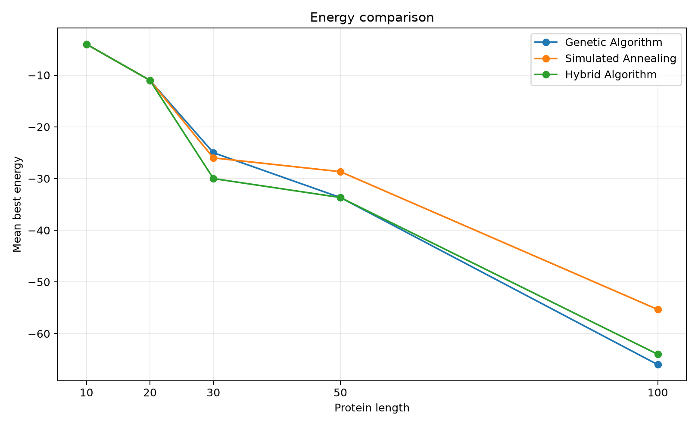
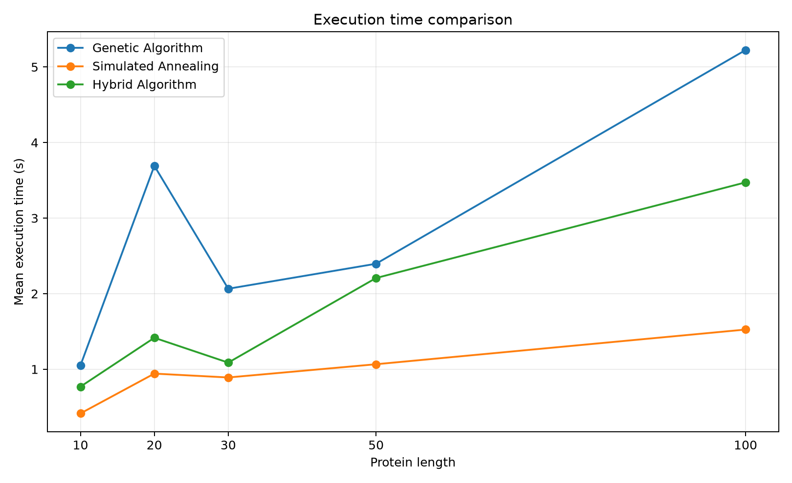
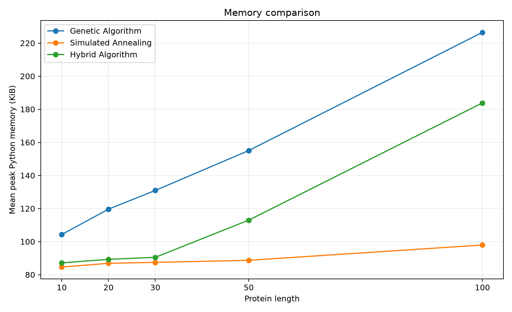

# AI-Based Protein Structure Prediction and Optimization

Design and Analysis of Algorithms (DAA) project implementing heuristic protein folding on a simplified three-dimensional cubic lattice using Python.

## Features

- 3D lattice representation with six possible movement directions.
- Collision detection and structural validation.
- Configurable contact energy function.
- Genetic Algorithm (GA), Simulated Annealing (SA), and a hybrid GA–SA approach.
- Collision pruning and rotational symmetry reduction by fixing the first direction.
- Evaluation budgets, execution time, peak Python memory allocation, and convergence tracking.
- Interactive 3D visualization and experimental comparison graphs.

## Installation and usage

Requires Python 3 (tested with Python 3.13) and Matplotlib.

```bash
python -m pip install matplotlib
python main.py
```

Select an algorithm (1–3), enter an amino acid sequence and an evaluation budget of at least 100, then optionally customize the energy parameters. The program calculates sequence length automatically.

Example sequence: `ACDEFGHIKLMNPQRSTVWY`.

Option 4 runs the benchmark and overwrites `experiment_results.csv`. To regenerate graphs from existing results without repeating experiments:

```bash
python plot_results.py
```

Run the basic correctness checks with:

```bash
python test_protein.py
```

## Protein model and objective

Each amino acid occupies an integer coordinate `(x, y, z)`. Consecutive residues must be one Manhattan-distance unit apart, and two residues cannot occupy the same coordinate. The objective is to minimize the sum of contact energies between nonconsecutive residues separated by one lattice unit. Invalid structures receive infinite energy.

| Interaction | Default energy |
|---|---:|
| Hydrophobic–hydrophobic | -2 |
| Opposite charges | -2 |
| Polar–polar | -1 |
| Same charge | +1 |
| Other | 0 |

These weights and residue categories are simplified modeling assumptions, not a calibrated physical force field.

## Algorithms

**Genetic Algorithm:** generates a population of valid structures, ranks them by energy, selects parents from the better half, and applies crossover and mutation. Elitism preserves the best solution; invalid offspring are replaced with randomly generated valid candidates when the budget permits. Stored energy scores avoid redundant evaluations during sorting.

**Simulated Annealing:** starts with a valid structure, proposes changes to its direction sequence, rejects invalid candidates, and accepts non-worsening energy changes or probabilistically accepts uphill moves using `exp(-delta / temperature)`. Cooling reduces the probability of accepting worse solutions over time. The best encountered solution is retained.

**Hybrid:** uses half the evaluation budget for GA, then starts SA from GA's best structure with the remaining budget.

## Search-space reduction

For n residues, the unrestricted direction encoding has 6^(n-1) possibilities. For n >= 2, fixing the first direction to R reduces this to 6^(n-2), eliminating five of six first-direction choices without losing an energy-equivalent orientation in the unconstrained isotropic model. During random generation, moves into occupied coordinates are excluded before completing a candidate. A hash set enables expected constant-time occupancy checks; a hash map supports checking six neighbors per residue rather than all residue pairs.

The reported pruning percentage is rejected moves divided by checked moves during random generation. It does not measure the proportion of the entire theoretical search space eliminated. Evaluation counts may include repeated configurations.

## Complexity

Let n be protein length, P population size, G generation count, and B evaluation budget. Hash operations are analyzed under expected constant-time access.

| Operation | Time | Auxiliary space |
|---|---|---|
| Coordinates / structural validation | O(n) | O(n) |
| Energy evaluation | O(n) | O(n) |
| Random generation | O(n) | O(n) |
| Mutation / crossover | O(n) | O(n) |
| Genetic Algorithm | O(Bn + GP log P) | O(Pn + B) |
| Simulated Annealing | O(Bn) | O(n + B) |
| Hybrid | O(Bn + GP log P) | O(Pn + B) |

The space estimates include convergence history. Without history, the corresponding B term is removed. GA parent selection uses a cached parent pool per generation. These bounds describe the implementation under the stated assumptions, not exhaustive exploration.

## Experimental results

Five synthetic sequences (lengths 10, 20, 30, 50, 100), three runs per algorithm and length, and 10,000 evaluations per run produced 45 records. The algorithms use matched trial seeds. Runtime and peak traced Python memory are measured separately with the same random state. All 45 recorded final structures were valid.

| Length | GA mean energy | SA mean energy | Hybrid mean energy |
|---:|---:|---:|---:|
| 10 | -4.00 | -4.00 | -4.00 |
| 20 | -11.00 | -11.00 | -11.00 |
| 30 | -25.00 | -26.00 | -30.00 |
| 50 | -33.67 | -28.67 | -33.67 |
| 100 | -66.00 | -55.33 | -64.00 |

Lower energy is better for a given sequence and energy model. SA had the lowest mean runtime and memory at every tested length. The hybrid gave the lowest mean energy at length 30, tied GA at length 50, and was outperformed by GA at length 100. No single method was universally superior.







Additional figures: [Valid configurations](protein_graphs/valid_comparison.png), [Pruning](protein_graphs/pruning_comparison.png).

## Repository structure

- `main.py`: protein representation, energy model, algorithms, measurement, visualization and CLI.
- `test_protein.py`: basic correctness checks.
- `experiment_results.csv`: raw benchmark results.
- `plot_results.py`: generates benchmark charts.
- `protein_graphs/`: generated PNG figures.

## Limitations and future work

This is a coarse lattice optimization project, not a validated atomic-resolution structure predictor. The algorithms are stochastic and do not guarantee a global optimum. The benchmark contains one synthetic sequence per length and only three trials, so conclusions are descriptive rather than general. Energy across different lengths is not directly comparable as a measure of biological accuracy. Memory refers to traced Python allocations including convergence history, not total process memory. Optional external structural constraints are not implemented. Future work could include multiple compositions per length, larger trial counts, exact small-instance baselines, and additional mutation operators.
